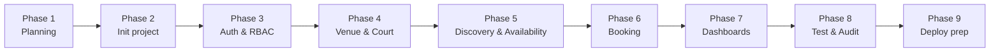

# SportsCourt — Implementation Roadmap

Status: **Phase 2 selesai** — Phase 3 siap dimulai setelah konfirmasi.

| Phase | Deliverable | Exit criteria (harus benar-benar dijalankan) |
|-------|-------------|-----------------------------------------------|
| **1. Requirement & Planning** ✅ | `DECISIONS.md`, `ERD.md`, `ARCHITECTURE.md`, `API.md`, `ROADMAP.md` | Disetujui user (D-01–D-08 & P-01–P-15 final) |
| **2. Project Initialization** ✅ | Cek versi PHP/Composer/Node/npm/MariaDB; `backend/` Laravel; `frontend/` Vite React TS + Tailwind; `.env.example`, `README.md`, `AGENTS.md`; DB `sportscourt` & `sportscourt_test` | `php artisan migrate:fresh` (tabel bawaan) & `php artisan test` sukses; `npm run typecheck`, `npm run lint`, `npm run build` sukses; kedua server diuji berjalan terpisah (catatan: root `.gitignore` dilewati karena permission denied, coverage ditangani `backend/.gitignore` & `frontend/.gitignore`) |
| **3. Auth & Authorization** | Migration `users` (role, status); Sanctum SPA, CORS, CSRF; register/login/logout/me/profile/password; `EnsureRole`, cek suspended; `app:create-admin`; halaman login/register + guard UX | Feature test auth, role, throttle, suspended; login–logout end-to-end dari browser tanpa 401/419 |
| **4. Venue & Court Management** | Migration `sports`, `venues`, `venue_images`, `operating_hours`, `courts`; seeder sports; owner CRUD; admin verification; upload aman; halaman owner & admin terkait | Test ownership/IDOR (owner A vs B), transisi status venue, validasi upload |
| **5. Discovery & Availability** | Listing/search/filter/pagination; detail venue; operating hours UI; `court_blocks`; `AvailabilityService` + endpoint; halaman explore & detail | Unit test availability (jam tutup, blok, booking, past, timezone WITA/WIT); tidak ada N+1 (cek query log) |
| **6. Booking** | Migration `bookings`, `booking_status_histories`; `BookingService` (lock, harga, transisi); confirm/reject/cancel; scheduler expire & complete; halaman booking & my bookings & incoming bookings | Test overlap (termasuk batas `[start,end)`), state transition, cutoff cancel, expiry, **concurrent booking di MySQL/MariaDB** (tepat 1 sukses) |
| **7. Dashboards** | Endpoint & halaman dashboard customer/owner/admin; admin users, sports, booking monitoring | Angka dashboard diverifikasi terhadap data seeder; test akses lintas role |
| **8. Testing & Security Audit** | Full test suite; audit OWASP (access control, IDOR, injection, XSS, CSRF, session, CORS, upload, mass assignment, rate limit, dependency `composer audit` / `npm audit`); `SECURITY.md` | Laporan audit beserta temuan & perbaikan; semua test kritis hijau dan hasilnya terdokumentasi |
| **9. Deployment Preparation** | Konfigurasi production (HTTPS, secure cookie, domain), strategi migrasi & backup, panduan deploy & rollback | Checklist deployment lengkap; tidak ada secret di repo |

## Urutan kerja per fitur (setiap phase)
1. Inspect kode existing → 2. Plan file yang diubah → 3. Migration/model/factory → 4. Request/Policy/Service/Controller/Resource → 5. Test backend → 6. API client + hooks + halaman frontend → 7. Typecheck/lint/build/test → 8. Update docs.

## Prasyarat lingkungan (dicek di Phase 2)
- PHP sesuai kebutuhan versi Laravel terbaru yang stabil (ekstensi: `pdo_mysql`, `mbstring`, `openssl`, `fileinfo`, `gd`/`intl` bila perlu)
- Composer 2.x
- Node.js LTS + npm
- XAMPP (MariaDB/MySQL berjalan di `127.0.0.1:3306`)
- Git
