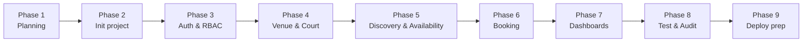

# SportsCourt — Implementation Roadmap

Status: **Phase 9 selesai.** Seluruh tahap implementasi MVP sudah tercatat.

| Phase | Deliverable | Exit criteria (harus benar-benar dijalankan) |
|-------|-------------|-----------------------------------------------|
| **1. Requirement & Planning** ✅ | `DECISIONS.md`, `ERD.md`, `ARCHITECTURE.md`, `API.md`, `ROADMAP.md` | Disetujui user (D-01–D-08 & P-01–P-15 final) |
| **2. Project Initialization** ✅ | Cek versi PHP/Composer/Node/npm/MariaDB; `backend/` Laravel; `frontend/` Vite React TS + Tailwind; `.env.example`, `README.md`, `AGENTS.md`; DB `sportscourt` & `sportscourt_test` | `php artisan migrate:fresh` (tabel bawaan) & `php artisan test` sukses; `npm run typecheck`, `npm run lint`, `npm run build` sukses; kedua server diuji berjalan terpisah (catatan: root `.gitignore` dilewati karena permission denied, coverage ditangani `backend/.gitignore` & `frontend/.gitignore`) |
| **3. Auth & Authorization** ✅ | Migration `users` (`phone`, `role`, `status`); Sanctum SPA, CORS, CSRF; register/login/logout/me/profile/password; `EnsureRole`, `EnsureUserIsActive`; `app:create-admin`; halaman login/register/profil + dashboard shell per role + guard UX | 34 feature tests (auth, role, throttle, suspended, CORS/CSRF, create-admin) hijau; `npm run typecheck`/`lint`/`build` 0 error & 0 warning; end-to-end CSRF cookie → register → me → logout → 401 terverifikasi di `http://localhost:8000` |
| **4. Venue & Court Management** ✅ | Migration `sports`, `venues`, `venue_images`, `operating_hours`, `courts`; seeder sports; owner CRUD; admin verification; upload aman; halaman owner & admin terkait | Test ownership/IDOR (owner A vs B), transisi status venue, dan validasi upload lulus di MariaDB `sportscourt_test`. Jam operasional bisa diubah di fase 5. |
| **5. Discovery & Availability** ✅ | Listing/search/filter/pagination; detail venue; operating hours UI; `court_blocks`; `AvailabilityService` + endpoint; halaman explore & detail | Unit test availability (jam tutup, blok, booking, past, timezone WITA/WIT) lulus. Query log daftar venue tidak bertambah per venue. |
| **6. Booking** ✅ | Migration `booking_status_histories` (tabel `bookings` sudah ada sejak phase 5); `BookingService` (lock court, harga, transisi); confirm/reject/cancel; scheduler expire & complete; halaman ajukan booking, booking saya, dan booking masuk | Test overlap (termasuk batas `[start,end)`), state transition, cutoff cancel, expiry, dan concurrent booking di MariaDB lulus: tepat 1 dari 2 proses berhasil. `php artisan test` 63 lulus, 381 assertion. Alur ajukan lalu konfirmasi dicek di browser localhost. |
| **7. Dashboards** ✅ | Endpoint dan halaman dashboard customer, owner, admin; admin kelola user dan olahraga; pantauan booking beserta riwayat status. `DemoDataSeeder` mengisi angka yang bisa dicek. Admin tidak dibuat seeder. | Angka dashboard dicocokkan ke konstanta seeder. Tes akses lintas role lulus. `php artisan test` 68 lulus, 458 assertion. |
| **8. Testing & Security Audit** ✅ | `docs/SECURITY.md`; tes akses asing sebelum validasi; cek lapangan tersembunyi; `composer audit` dan `npm audit` | `php artisan test` 71 lulus, 469 assertion. `composer audit` tanpa advisory. `npm audit` 0 kerentanan. Login tanpa CSRF 419. Dua temuan kebocoran 422 diperbaiki. |
| **9. Deployment Preparation** ✅ | Contoh env production, panduan XAMPP di README, `docs/DEPLOY.md` (cadangan dan rollback), `backend/database/export/sportscourt.sql` | Dump dibuat dengan `migrate:fresh --seed` di MariaDB 10.11.14. Impor ke database kosong berhasil: 4 user, 4 venue, 4 court, 7 booking, 5 olahraga. Password di file adalah hash `$2y$`, dan cek login demo berhasil. |

## Urutan kerja per fitur (setiap phase)
1. Inspect kode existing → 2. Plan file yang diubah → 3. Migration/model/factory → 4. Request/Policy/Service/Controller/Resource → 5. Test backend → 6. API client + hooks + halaman frontend → 7. Typecheck/lint/build/test → 8. Update docs.

## Prasyarat lingkungan (dicek di Phase 2)
- PHP sesuai kebutuhan versi Laravel terbaru yang stabil (ekstensi: `pdo_mysql`, `mbstring`, `openssl`, `fileinfo`, `gd`/`intl` bila perlu)
- Composer 2.x
- Node.js LTS + npm
- XAMPP (MariaDB/MySQL berjalan di `127.0.0.1:3306`)
- Git
